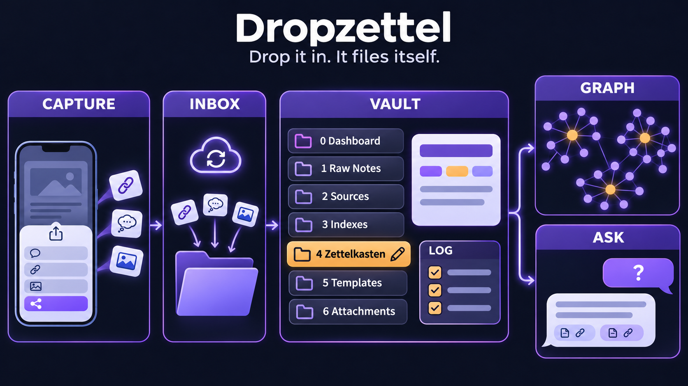

# Dropzettel



**A Zettelkasten for people who are too lazy to keep one.** Drop a link, a thought or a screenshot into a synced folder. It is filed into your Obsidian vault as a tagged, linked note, and a log tells you where it went and why.

I built an Obsidian Zettelkasten once and abandoned it after three weeks. Every capture needed about six decisions (folder, template, tags, index, status, links), so my notes kept ending up in WhatsApp messages to myself and in bookmark folders I never opened. Dropzettel splits the work: you capture and you think, and the machine does the filing.

```
phone / Mac ──▶ inbox folder ──▶ dropzettel.py ──▶ Obsidian vault
 share sheet     (Dropbox,        fetch, read,      note + tags + topic + links
 or drag a file   iCloud, any     classify, file    Capture Log entry
                  synced folder)                    To Check dashboard, weekly review
```

## What you get

- **One door in.** Everything goes into one inbox folder: links, link plus a comment, plain thoughts, PDFs, screenshots, YouTube and X links, Word documents, lists of links. No folder choice, no template, no tags at capture time.
- **A filed note per capture.** A summary, key points, why it might matter to you, tags reused from your existing vocabulary, one topic index, and links to related notes you already have. Your own words are kept verbatim at the top.
- **A log of every decision.** One entry per capture in `0 - Dashboard/Capture Log YYYY-MM`:

  ```markdown
  ### 2026-11-24 19:39 — [[Zettelkasten (Wikipedia overview)]]
  - **Captured:** `phone-1.txt` at 2026-11-24 19:00 → <https://en.wikipedia.org/wiki/Zettelkasten>
  - **Filed as:** article → `2 - Sources/Articles/Zettelkasten (Wikipedia overview).md`
  - **Tags:** `zettelkasten` `note-taking` · new: zettelkasten, note-taking
  - **Topic:** [[Note-Taking]] (new index created)
  - **Status:** to-check (to read)
  - **Why:** Wikipedia article on the method; the owner wants to compare it with how they keep recipes. (confidence 60%)
  ```

- **Things come back to you.** A `To Check` dashboard, and a weekly review that points out connections and proposes one to three notes worth writing in your own words.
- **A vault you can ask.** The vault ships with an `AGENTS.md`, so an AI agent opened in it (Claude Code, Codex, Gemini CLI) answers from your notes, cites them, and says so when the vault has nothing.
- **Your permanent notes stay yours.** Nothing automatic ever writes to `4 - Zettelkasten`.

## The vault structure

The starter vault is in [`vault-template/`](vault-template). Setup creates it, or adds the missing folders to a vault you already have. Folder names are configurable.

| Folder | Contents | Written by |
|---|---|---|
| `0 - Dashboard` | Capture Log, To Check, Tag Registry, Weekly Reviews | Dropzettel |
| `1 - Raw Notes` | Your thoughts, ideas, questions, as captured | Dropzettel, from your words |
| `2 - Sources` | One note per link, video, paper, tool or file, in subfolders by kind | Dropzettel |
| `3 - Indexes` | One hub note per topic | Dropzettel appends; you reorganise |
| `4 - Zettelkasten` | Permanent notes: one idea each, in your own words | Only you |
| `5 - Templates` | Templates for the notes you write | You |
| `6 - Attachments` | Images, PDFs and files that came through the inbox | Dropzettel |

Every filed note carries frontmatter (`type`, `kind`, `status`, `action`, `captured`, `tags`, `topics`, `summary`, `url`), so Dataview and Obsidian's property search work on it.

## Requirements

- macOS for the full setup (background jobs, phone shortcut, HEIC and Word conversion). The processor itself is plain Python and runs anywhere.
- Python 3.10 or newer.
- [Claude Code](https://claude.com/claude-code) installed and signed in. Dropzettel calls the `claude` command for classification, so there is no API key to manage.
- [Obsidian](https://obsidian.md) with the Dataview community plugin, for the dashboard.
- Optional: `yt-dlp` (YouTube transcripts), `pdftotext` from poppler (PDFs), `tesseract` (OCR backup for images).

  ```bash
  brew install yt-dlp poppler tesseract
  ```

## Install

```bash
git clone https://github.com/osencan/dropzettel.git
```

```bash
cd dropzettel && ./setup.sh
```

Setup asks where your vault and inbox live, writes `config.json`, prepares the vault, builds the phone shortcut, and offers to install the background jobs. It installs nothing that runs by itself unless you answer yes. Run `./setup.sh --help` for the unattended flags.

## Capturing

**On the Mac:** save or drag anything into the inbox folder. A `.txt` file holding a link, optionally followed by a blank line and a sentence of why, is the basic capture.

**On the iPhone:** setup produces `Dropzettel.shortcut` in your data folder. AirDrop it to the phone and tap *Add Shortcut*.

- Share sheet → *Dropzettel* → type why you saved it, or leave it empty.
- Add it to the Home Screen for thoughts: tap, type or dictate, done.
- Photos, PDFs and files: share sheet → *Save to Dropbox* or *Save to Files* → the inbox folder.

A sentence of "why I saved this" is the most useful thing you can add. The librarian weighs it most, and it is what you will want to read in six months.

## Sync options

| Option | Inbox lives in | Phone shortcut | Status |
|---|---|---|---|
| **Dropbox** | `Dropbox/Dropzettel/inbox` | Uses Shortcuts' built-in *Save Dropbox File* action | In use by the author |
| **iCloud Drive** | `iCloud Drive/Shortcuts/Dropzettel/inbox` | Uses the *Save File* action | Experimental: built and signed, not yet run on a phone |
| **Any synced folder** | Wherever you point it (Syncthing, Google Drive, a NAS) | None; save text files into it your own way | Processor tested, capture is up to you |

Details and known issues are in [docs/sync-options.md](docs/sync-options.md).

## Running it

With the background jobs installed, the inbox is processed about a minute after something lands, and a weekly review is written on Sundays at 18:00. Without them:

```bash
./run.sh --home ~/Dropbox/Dropzettel process
```

```bash
./run.sh --home ~/Dropbox/Dropzettel status
```

```bash
./run.sh --home ~/Dropbox/Dropzettel digest
```

To remove the background jobs:

```bash
./setup.sh --uninstall-jobs
```

## Configuration

`config.json` in your data folder. Only `vault` is required; see [`config.example.json`](config.example.json).

| Key | Default | Meaning |
|---|---|---|
| `vault` | | Path to the Obsidian vault |
| `inbox` | `<data folder>/inbox` | Folder that is watched |
| `model` | `sonnet` | Claude model alias: `haiku`, `sonnet` or `opus` |
| `note_language` | `English` | Language of summaries. Your own words are never translated |
| `owner_context` | | One or two sentences about you, so "why it might matter" is about you |
| `ocr_languages` | `eng` | Tesseract languages, such as `eng+deu` |
| `ignore_tags` | `[]` | Tags in old notes that should not enter the vocabulary |
| `folders`, `source_subfolders` | see above | Rename any vault folder |
| `max_items_per_run` | `25` | Upper limit per run, so a big backlog cannot burn through your plan |

## Privacy and safety

- **What leaves your Mac:** the text of each capture (the fetched page, extracted file text, or the image) plus your existing tags, topic names and note titles go to Claude through your own Claude Code sign-in. Links are fetched from your Mac. Nothing else is sent anywhere.
- **The model cannot touch your files.** It is called with every tool switched off and must answer in a fixed JSON shape. The script does all file operations and sanitises what comes back. A hostile web page can, at worst, produce an odd summary.
- **Nothing is deleted.** Files move into the vault (`6 - Attachments`) or into `processed/` in your data folder. Anything that cannot be filed moves to `failed/` with a log entry.
- **Existing notes are never rewritten.** Index notes get new lines under a `## Captures` heading and nothing else.
- **Signing the shortcut** sends the shortcut file (the action list and your inbox path) to Apple. That is how `shortcuts sign` works.

## Cost

Each capture is one model call on your Claude plan. In the author's use a short thought or a tweet is a cent or two of plan usage on Opus, and less on Sonnet or Haiku. A multi-hour video transcript is the expensive case.

## Limitations

- Tested on one Mac (macOS 27) and one iPhone. Expect rough edges elsewhere.
- Classification needs the Claude CLI. Other model backends are not implemented; `llm_json()` in `dropzettel.py` is the single function to replace.
- Pages behind a login or paywall are filed from the URL and your comment only, and marked for review.
- Notes that existed before Dropzettel are not in the duplicate index, so a link you already had a note for is filed again and linked to the old note.
- The WhatsApp chat importer is experimental; see [Importing a WhatsApp chat](#importing-a-whatsapp-chat-experimental).
- The background jobs only run while you are logged in on the Mac.

## Importing a WhatsApp chat (experimental)

If your notes live in a WhatsApp chat with yourself, `import-whatsapp` turns that chat into captures. It is a subcommand of the processor (`cmd_import_whatsapp` in [`dropzettel.py`](dropzettel.py)) and makes no model call itself: it only splits the export into one text file per message and writes those into the inbox.

1. In WhatsApp, open the chat → *Export Chat* → *Without Media*. Unzip the result if it is a zip; you need the `.txt` file inside (`_chat.txt` on iPhone).
2. Run the importer on it:

   ```bash
   ./run.sh --home ~/Dropbox/Dropzettel import-whatsapp ~/Downloads/_chat.txt
   ```

3. The messages are filed like any other capture: by the background job, or by running `process`.

Each message becomes `wa-<date and time>-<number>.txt` in the inbox, holding the message text and a line such as `(from WhatsApp, 24.11.2026 10:15:02)`. Multi-line messages stay together.

What to know before you run it on a long chat:

- **Every message is one model call.** A chat with 800 messages is 800 captures. At most `max_items_per_run` (default 25) are filed per run; the rest wait in the inbox for the next run.
- **Everyone's messages are imported**, not only yours, and the sender's name is dropped. It is meant for a chat with yourself. For a group chat, delete the lines you do not want from the export first.
- **Media is skipped.** Export without media; "image omitted" placeholders are ignored (the English wording only). Save photos and PDFs into the inbox yourself.
- **The note's capture date is the import date.** The original WhatsApp date is kept as text in the note.
- **Importing the same export twice** files links only once, but plain-text thoughts are filed again.
- **Date formats:** checked against two invented samples, the iPhone layout (`[24.11.2026, 10:15:02] Name: text`) and the Android layout (`11/24/26, 9:06 PM - Name: text`). Other regional layouts may not be recognised; the importer prints how many messages it parsed, so compare that with what you expect.

To try it safely, cut the export down to ten lines first and look at the files that appear in the inbox.

## Asking your vault

Open an AI coding agent in the vault folder and ask: "What have I saved about onboarding flows?" or "Which of my captures connect to the project I am starting?" The `AGENTS.md` in the vault tells it to search your notes first, cite them, keep your words apart from the librarian's, and say when the vault has nothing.

## Not affiliated

Dropzettel is an independent project. It is not affiliated with or endorsed by Dropbox, Apple, Obsidian or Anthropic. Their names are used only to describe what it works with.

## Acknowledgements

Dropzettel was built with [Claude Code](https://claude.com/claude-code), with support from the [Claude for Startups program](https://claude.com/programs/startups). Thank you to the team behind it.

## Support

If Dropzettel keeps your notes out of your WhatsApp self-chat, you can support its development at [github.com/sponsors/osencan](https://github.com/sponsors/osencan).

## License

MIT. See [LICENSE](LICENSE).
